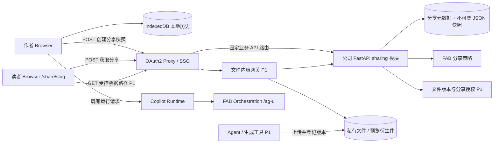
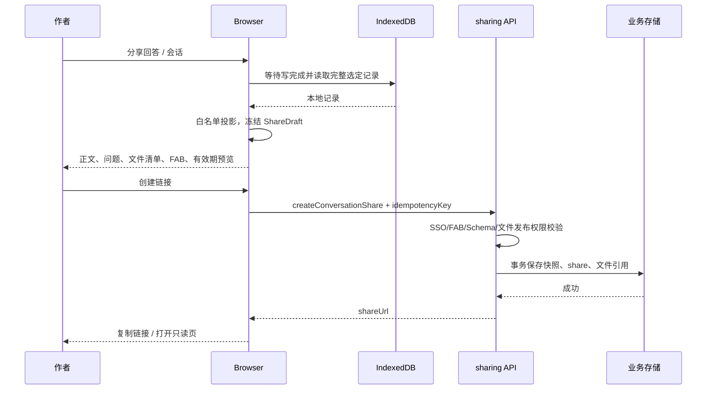

# AgentDock 回答与会话分享架构设计

> 日期：2026-10-14
>
> 状态：设计提案，尚未实现
>
> 范围：在现有本地历史、Service、SSO、FAB 与代码预览架构上增加分享
>
> API 字段唯一来源：`../04-frontend-backend-api.md` §14

## 1. 方案选择

采用“前端投影选定内容 → 公司业务服务持久化不可变快照 → 接收方只读渲染”的方式。

原 Session 继续保存在 IndexedDB。分享服务只保存用户明确发布的内容副本，并管理其受众、失效时间、文件授权与撤销状态。分享内容不会随原会话继续生成而变化；重新选择内容时创建新链接。

首版以单 FAB 的普通文本回答为范围，提供单轮回答和选定会话内容分享。要求公司 SSO，默认受同一 FAB 的分享阅读策略约束。HTML/SVG/Mermaid/Markdown 仍来自正文 fenced code，复用现有安全预览。文件附件作为后续文件服务能力接入。

这项能力不要求把全部会话历史迁移到服务器，也不要求恢复 LobeHub 原生 Share 后端。公司现有业务数据库可以承担分享元数据和快照持久化。

## 2. 代码现状与设计影响

| 当前代码 / 文档 | 实际能力 | 对分享的影响 |
|---|---|---|
| `src/api/session/sessionHistoryService.ts` | Dexie `sessions`、`sessionMessages`、`checkpoints`；历史按 sequence 排序 | 服务端只有 sessionId 不能读取 Browser 历史，创建分享必须提交内容 |
| 同文件 `persistRunSnapshot` | 一轮中间 assistant 正文存为 `narration + timelineText`，最后 assistant text 作宿主 | 直接分享最后 record.content 会遗漏用户看到的正文 |
| 同文件 `flushRunCheckpoint / waitForRunCheckpoint` | 每 run 防抖与串行写队列 | 新回答分享前需要等待终态写入，防止读取旧内容 |
| `src/api/session/sessionStorageService.ts` | JSON 备份可包含 checkpoint/input/snapshot | 备份格式不直接用作分享格式；分享需字段白名单 |
| `src/features/chat/messageTimeline.ts`、`messageBlockOwnership.ts` | 合并气泡、解析每 run 的过程块宿主 | 可复用顺序与宿主规则，正文投影应与聊天一致 |
| `src/features/chat/components/MessageActions.tsx` | share 图标已经存在，但 disabled | 后续增加 `onShare` 回调，由页面传实际 target |
| `src/features/chat/htmlArtifact.ts` | HtmlArtifact 是 CodePreview 别名，内容来自完整 fence | 这些预览内容可随正文快照保存，不需要上传独立文件 |
| `src/features/chat/components/CodePreviewRenderer.tsx` | HTML sandbox/CSP、SVG 净化、Mermaid/Markdown renderer | 分享预览复用；不能从存储直接将 HTML 放进宿主 DOM |
| `src/api/artifact/artifactService.ts` | 列表/详情/创建/删除与 Mock 内容模型 | 不具备真实二进制存储、持久版本或文件访问授权，不能视作现成文件系统 |
| `src/app/providers.tsx`、`src/app/App.tsx` | 全局 CopilotKit/Runtime Host，全页面包在 AppShell 内 | 仅增加 route 会带上工作台初始化；分享页需布局及启动边界 |
| `src/lib/httpClient.ts` | 同源 POST、credentials include、envelope | 分享 REST 继续使用 postApi，无需单独 transport |
| `server/index.ts` | 托管静态产物、Runtime 和 Run Control | 不在 Node 进程内存中保存分享；分享由公司 FastAPI 持久化 |

历史基线曾永久移除 Share；本次是 AgentDock 自有分享的后续设计提案。`design/19` 已撤销 Artifact Activity；本方案保持该决定，文件引用协议另行评审，不把分享变成新的 AG-UI Action。

## 3. 部署拓扑与团队职责



| 层 | 职责 |
|---|---|
| Browser | 选择内容、读取本地历史、投影 DTO、预览、创建/管理分享、只读渲染 |
| OAuth2 Proxy | 可信 SSO 身份注入、固定路径转发、登录后回跳 |
| 公司 FastAPI sharing 模块 | Schema/尺寸校验、FAB 发布和阅读权限、不可变快照、幂等、过期与撤销、文件 grant |
| 文件服务 / 网关（P1） | 上传确认、版本身份、私有对象存储、预览产物、受控传输、文件保留 |
| Agent / Orchestration | 生成文件时登记产物并返回可持久引用；正文继续普通 Markdown |
| AgentDock App Server | 已有静态 SPA fallback 和 Runtime/Run Control |

首期建议把 sharing 作为公司 FastAPI 的一个模块，与目前普通业务 API 上游同部署。若需要独立服务，只为分享接口增加固定路由；路由不会由请求中的 FAB 改变，FAB 是授权和内容域字段。

`/share/:shareSlug` 的页面 GET 走前端 SPA fallback，数据 POST 走公司业务服务。P1 的 `/api/shared-files/*` 必须比兜底 `/api/*` 优先路由到文件网关，不能被 App Server 静态 fallback 吞掉。

## 4. 分享什么，以及如何保持内容一致

### 4.1 分享专用 DTO

数据类型以 API §14 为准。v1 snapshot 只包含：schemaVersion、title、scope、按序 turns、用户/助手展示身份、Markdown 正文、可选文件引用和 partial 标记。

默认排除 reasoning、原始 tool 参数和结果、内部 state、rawEvents、RunAgentInput、checkpoint、HITL 输入/恢复令牌、A2UI Action、任意未知 payload。排除意味着这些字段不会上传，不只是页面折叠或隐藏。正文中已有的信息仍然会被分享，预览用于用户核对。

`ShareSource` 只用来追溯来源。它不包含原运行状态，不返回给读者，也不允许读者通过 threadId 恢复作者的会话。Snapshot turn 使用新 ID，避免渲染器把它误认作本地消息。

### 4.2 单轮回答的正文投影

用户点击“分享回答”时，target 应包含 `{ sessionId, runId?, hostMessageRecordId }`，不能只传字符串 `content` 或假设 `messageId` 等于整轮回答。

1. 读取该 Session 的消息记录，并过滤 deletedMessageIds、诊断记录、`lc_run--` 占位。
2. 按现有 sequence、process-host 和 display-unit 规则定位所选回答。
3. 该 run 存在 `narration` 且 `payload.timelineText=true` 时，取全部有效 narration 正文，按顺序组成一个 assistant turn；不能再追加宿主 record.content 造成重复。
4. 没有 timeline narration 时回退宿主 assistant text 正文。
5. 应用与聊天一致的错误文本去重；中断/错误但有正文的回答标记 partial。
6. 用户勾选“包含问题”时，仅添加确实对应这一轮的 user 消息，预览中逐字展示；无法明确关联时让用户显式选，不能猜测或补齐先前上下文。

建议将聊天里的正文选择和错误文本去重提取为纯函数，聊天操作与分享投影共用。分享只是多一层字段筛选，不复刻另一套排序算法。

### 4.3 会话分享与快照读取屏障

聊天目前分页加载历史，DOM 或 `ChatPage.history` 可能只有最近 50 条文本。会话分享必须使用 `sessionHistoryService` 读取完整选定范围，不能导出当前可见列表。首版超过数量/尺寸限制时让用户缩小范围，不自动遗漏早期消息。

选定正在 running/paused 的当前轮不允许创建分享；仍可分享之前已经保存的轮次。对话快照排除不完整尾部，并在预览里显示排除数量。终态 cancelled/error 可显式选择已生成内容，读者看到 partial 标记。

新终态回答的读取顺序：

```text
确认 target 已结束 / 固定选中的轮次与记录边界
    → flushRunCheckpoint(selectedRunId)
    → waitForRunCheckpoint(selectedRunId)
    → IndexedDB 只读事务读取 session 与选定消息
    → 检查必需正文存在，生成白名单 DTO
    → 固定 ShareDraft，并用同一 DTO 展示预览和提交
```

现有 `waitForRunCheckpoint` 会吞掉写错误，只能证明写链结束。分享读取还必须检查终态内容是否落盘；实现时应补充“终态持久化成功”结果或可拒绝的读取屏障。失败时提示重试；也可以经用户选择从已经冻结的内存 ViewModel 构建副本，但不能静默回退到旧 DB 文本。

只读事务获得一致读取；它不能替代前面的写完成屏障，因为 `persistRunSnapshot` 有多个写步骤。后续新增轮次或跨标签页写入不能进入已选中的快照：以固定 run/record 集合和 sequence 截止点读取，再冻结实际 DTO。用户点击创建时提交预览中的 draft，不重新读取最新会话。

终态 checkpoint 当前会删除，因此不能拿“checkpoint 不存在”证明 Run 成功。历史来源无法确认运行终态时，使用 saved 语义，不伪造成功标记。

## 5. 创建、阅读与撤销链路



请求超时后沿用同一 idempotencyKey 重试。同 owner/key 的相同输入返回原链接，不重复产生分享；不同输入返回冲突。事务提交后才能返回可访问链接，失败不能留下只有正文、缺失文件 grant 的 active share。

读者完成 SSO 后，调用 getSharedConversation；后端校验当前租户、FAB 分享阅读权限、过期和撤销状态，再返回白名单 DTO。分享页不创建本地 Session，也不触发 run/connect/restore/HITL/A2UI。

撤销更新服务端 share 状态；后续读取和获取文件票据都拒绝。共享页已经加载的内容或下载后的副本无法追回。首版响应使用 `Cache-Control: private, no-store`；如以后加入 CDN/Redis 缓存，授权和 share 状态仍需实时校验，不能让旧缓存绕过撤销。

## 6. 后端数据模型与权限

### 6.1 持久化模型

| 表 / 集合 | 建议字段 | 目的 |
|---|---|---|
| `conversation_shares` | shareId、slug、tenantId、ownerId、fab、snapshotId、status、expiresAt、createdAt、revokedAt、idempotencyKey、requestHash、sourceMetadata | 链接和管理状态；sourceMetadata 仅后端追溯 |
| `share_snapshots` | snapshotId、schemaVersion、payloadJson、payloadHash、createdAt | 不可变正文副本；首版 JSON 直接存现有业务 DB |
| `share_file_grants`（P1） | shareId、fileId、versionId、preview、download、retentionReference | 把所选固定文件版本授权给该分享受众 |
| `files / file_versions`（P1 文件域） | fileId、versionId、tenantId、fab、owner、storageKey、mimeType、sizeBytes、sha256、previewRefs、state | 文件实际身份和版本；storageKey 不返回 Browser |

唯一约束：slug 唯一；`tenantId + ownerId + idempotencyKey` 唯一；每 share 中 `fileId + versionId` 唯一。分享列表按 owner/createdAt 分页，索引和清理任务按现有公司数据库规范实现。

首版不需要事件重放存储和长期 Redis event log。正文尺寸有上限，直接存业务 DB 足够形成最小闭环；后续量大时再迁到受控 blob 存储，DTO 与读取接口不变。

### 6.2 FAB 与来源约束

默认读者条件为“同 SSO 租户且具备该 FAB 的 canReadShare”，作者管理条件为“owner 匹配”。发布要求 canPublishShare，查看分享和调用 Agent 的权限分别由业务服务判断。现有 callPermission 不能自动授权所有分享文件。

shareSlug 是不可猜测的资源定位符，不能绕过 SSO。Backend 信任 Proxy 注入的 principal，不信任 Browser 传 userId、tenantId、FAB 成员列表或角色。获取文件时既要确认文件确实出现在该 share，也要确认固定版本、用途和权限。

当前本地消息本身是可编辑的 Browser 数据。后端能证明谁发布了什么副本、附件是否属于可分享范围，不能仅凭 sessionId/runId 证明正文就是某 Agent 的真实输出，也无法自动发现已粘贴正文中的全部来源。产品展示“用户分享的内容副本”，不展示“服务端已验证的原始执行”。创建快照时将 FAB 作为用户确认的内容分类并由后端校验其发布权限。

涉及多个 FAB 的群成员、委派结果或附件时，首版应提示暂不支持跨 FAB 分享。后续需要可靠的来源域登记，阅读条件取所有来源域授权的交集；不能只拿主 Session 的 FAB 扩大传播范围。若公司要求强制验证所有文本来源，需先补受信执行产物索引或签名来源声明，再开放对应分享范围。

## 7. 附件与内嵌内容

### 7.1 当前代码块

HTML/SVG/Mermaid/Markdown fence 是正文的一部分，分享时保存源码，读者点击“预览”时调用当前 CodePreviewRenderer。由正文构建的 inline artifactId 只是本地预览标识，不能作为远端文件主键。

HTML 保留 sandbox/CSP，SVG 保留净化，Mermaid 使用受限配置；分享页采用同一套预览策略。为识别真正可预览的内容，仍只接受完整显式 fence。分享预览不自动执行脚本、不发送 A2UI Action。

### 7.2 生成的 PPTX/PDF/图片文件

文件链路建议为：生成工具写入执行环境 → 文件服务上传/确认 → 生成 fileId/versionId → 消息得到引用 → 前端选择引用加入 ShareDraft → sharing 创建 grant。

上传到私有存储和创建分享授权是两个动作。普通下载也需要稳定文件身份，因此建议产物完成后就登记上传。若文件仅在本地，可在分享前由 Browser 经文件 Service 上传并确认；若只在远端临时执行目录，Browser 无法访问，应由生成工具或执行环境负责导出。分享服务不能靠文件名去远程机器寻找文件。

附件引用固定版本。重做 PPT 生成新 versionId 或 fileId，已分享链接仍指向旧版本。文字快照不保存临时 URL；blob URL、本机路径、sandbox 路径、带临时签名的 URL 不具有跨设备分享能力。

`artifactService` 当前类型只有 content 字符串。新增文件域前应先评审上传、版本、发布权限和引用协议；可以逐步接入 Agent 的标准工具结果元数据，不恢复已撤销的 Artifact Activity。仅解析普通 Markdown 下载链接无法可靠确认归属或版本。

### 7.3 文件读取与即时撤销

分享文件 ticket 固定绑定 share、用户、file/version、用途和有效期。Reader 用 ticket 访问同源文件网关；网关每次检查分享及 FAB 策略，再流式读取对象存储。预览 PDF、页缩略图与原 PPT 一样受授权约束。

直接返回对象存储短时预签名 URL 可减少网关带宽，但 URL 在有效期内可能继续访问，撤销只能到期后完全生效。本方案优先满足立即阻止撤销后的新请求，首版采用受控网关。文件内容是 GET/Range 的二进制传输例外；控制面仍遵守现有 POST/envelope。

### 7.4 内嵌图片、外部链接与生命周期

不能只处理附件卡：Markdown 图片、HTML/SVG 引用的资源、PDF 预览派生资源都应纳入文件清单。P0 遇到 blob/本机/临时路径显示不可分享提示或占位；P1 把确认过的文件映射为固定引用。保留普通外链意味着读者仍依赖源系统权限，不自动开放云盘文件。

分享模块不接受任意 URL 自动抓取附件。远端导入如有必要，由文件域在固定来源白名单和作者源权限下实现。修改链接及占位后，预览和提交必须使用同一份 draft，且不能误写代码块内的示例路径。

文件生成时可有短暂执行缓存；已发布且 active 的 share 为引用版本建立保留引用，不能因原 run 的 TTL 被提前回收。share 过期/撤销后解除保留，按其他会话/文件库引用和公司保留策略决定删除。清理本地历史不删除分享副本；UI 在清理时提供前往“管理分享”的入口。源文件被合规删除时，share 中显示文件已不可用，不能绕过删除再复制恢复。

## 8. 前端落点与只读页面

建议新增路径：

```text
src/types/share.ts                              分享领域 DTO
src/api/share/shareService.ts                    interface / HTTP / Mock / selected instance
src/api/session/sessionShareSourceService.ts      本地读取屏障与选定记录读取
src/mock-data/share.ts                           开发用分享状态
src/features/share/SharePage.tsx                  独立只读页
src/features/share/components/ShareDialog.tsx     选择、预览、受众、有效期、提交
src/features/share/components/ShareViewer.tsx     创建前预览与读者页共用
src/features/share/components/SharedMessage.tsx   只读 ChatItem + Markdown
src/features/share/buildShareSnapshot.ts          纯函数白名单投影
src/features/share/hooks/useCreateShare.ts        异步阶段、幂等、重试
```

页面只调用 Service。文件上传和票据传输仍在文件/分享 Service 内，组件不直接 fetch。主题/i18n 复用已有 Provider，全部新增静态文案补齐 18 种语言。

现有文件改动点：

- `MessageActions.tsx`：增加可选 onShare，由 ChatPage/GroupChatPage 决定是否可用，不在组件中读 store 或发请求。
- `ChatPage.tsx`：绑定实际记录 target；ChatHeader 增加会话分享入口；避免把 `current-assistant` 这个 DOM ID 当作消息主键。
- `sessionHistoryService.ts`：通过 Service 暴露一致读取和可感知写成功的屏障，保留 IndexedDB 内部访问边界。
- `router.tsx`：增加 `/share/:shareSlug`；routes 仍在这一个文件声明。
- `App.tsx` / `providers.tsx`：分享页用独立 layout，直接打开时跳过 AppShell、侧边栏会话请求、GroupCreateModal、CopilotKit 与 SessionRuntimeHost 初始化。
- `Markdown.tsx`：增加只读用途选项，受控附件链接通过分享票据打开；Agent mention 保留静态名字，不能因此请求市场或启动 Agent。
- `SettingsPage.tsx`：增加“管理分享”列表、打开和撤销；此列表由后端 owner 查询，不依赖本地会话是否存在。

Runtime Host 当前全局常驻。打开分享链接默认新标签页，工作台已有 Run 正常继续。若用户在同一标签页导航到 share 路由，保留已初始化且忙碌的 Runtime island；只读页不注册任何新 Session Worker。不能为隔离分享页而直接卸载现有 Host、中断后台任务。首次从链接冷启动 share 页面则不初始化 Runtime。

ShareViewer 用于创建前预览和发布后的阅读，保证筛选规则和静态显示一致。仅传递 copy、preview、获授权的 download 回调；不传 feedback、restoreToInput、sendA2uiAction、respondHitl。动态 A2UI 和过程块第一阶段不进入 snapshot。后续需要过程信息时增加专门摘要类型，不能把旧 payload 整包放行。

## 9. 交付阶段与验收

| 阶段 | 交付 | 上线依赖 |
|---|---|---|
| P0 文字分享 | 快照 DTO、完整读取/正文投影、预览、四个分享 API、只读页、管理/撤销、SSO/FAB | 公司 FastAPI sharing 模块与持久存储；后端确认 FAB 分享策略 |
| P1 文件分享 | 文件引用、固定版本、grant/保留、ticket/网关、图片/PDF/PPT 预览接入 | 文件服务及产物导出；来源元数据；预览衍生件转换 |
| P2 更多场景 | 过程摘要、复杂群聊、跨 FAB、指定成员、快照更新、从副本新建会话 | 可靠来源域及独立授权机制；明确分叉执行语义 |

文字分享可先上线，现有 fence 预览已经包含在 Markdown 中。若没有共享业务服务，Mock 只能演示当前开发环境，换设备/换用户不能依赖 Mock 或 IndexedDB 读取链接。

实施时应验证：

1. 冷启动 Reader 无本地历史也能读取合法分享；没有任何 `/api/copilotkit` Run/Connect 请求。
2. 一轮多段 narration 正文与作者预览一致，没有正文遗漏、重复或过程 JSON。
3. 会话历史超过当前 UI 分页窗口时仍读取全部选定范围；超限制明确拒绝。
4. running/paused 目标不可分享；终态立即点击分享等待写入；写失败不会发布旧内容。
5. 分享后的新消息不进入旧链接；本地删除/清理后链接按远端生命周期保留。
6. 默认 payload 不含 checkpoint/input/reasoning/raw tool/HITL/A2UI Action。
7. 跨租户/FAB、猜测 slug、替换 file/version 均无法取得正文或文件；权限变化立即生效。
8. 同一请求网络重试不产生多个 share；改变内容不复用旧幂等 key。
9. 撤销后新 ticket/GET/Range 都失败，预览衍生件没有公开旁路。
10. HTML/SVG 恶意脚本、外链和主动内容按现有 renderer 策略处理；用户点击不执行原 Agent 动作。
11. 工作台后台 Run 在打开/关闭分享页时仍按现有多 Session 机制继续。

本次仅交付设计文档；以上是后续实施验收条件，不表示这些功能已实现或测试通过。

本次文档交付检查：`git diff --check` 与 `pnpm run build` 通过。构建仍报告现有大 chunk 提示；本次未修改应用代码，也未执行分享功能测试。
